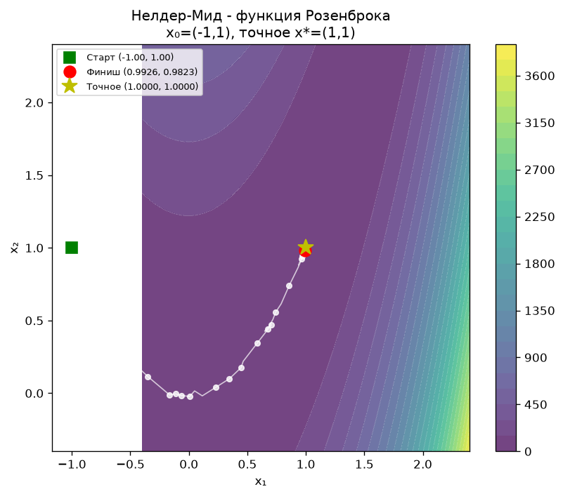
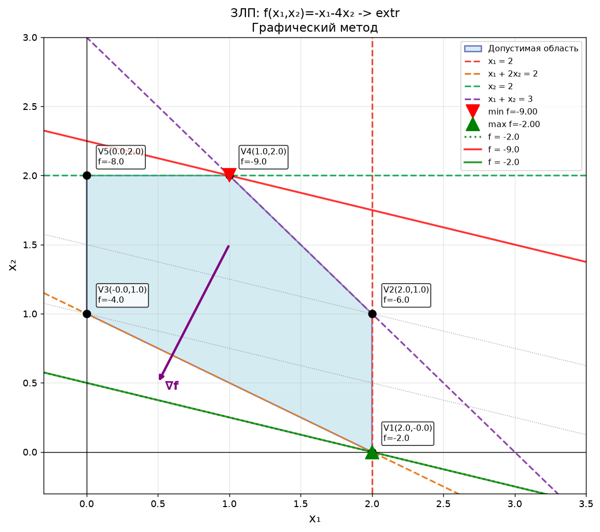
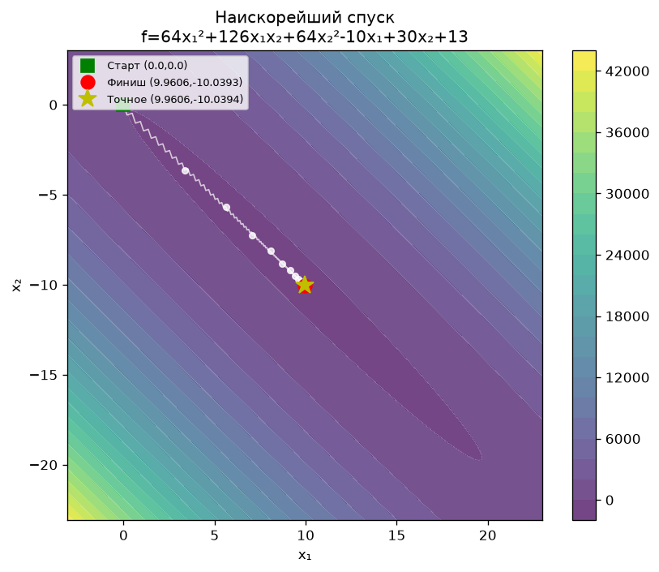

# Методы оптимизации на Python

Лабораторные по курсу «Методы оптимизации»: одномерный и многомерный поиск минимума, градиентные методы, случайный поиск, линейное и нелинейное программирование. Методы написаны вручную, а результат каждого сверяется с `scipy.optimize`.



## Лабораторные

| Файл | Тема | Методы |
|---|---|---|
| [lab1_direct_1d_search.py](lab1_direct_1d_search.py) | Прямые методы одномерной минимизации | поразрядный поиск, метод парабол, метод ломаных |
| [lab2_1d_newton_methods.py](lab2_1d_newton_methods.py) | Одномерная минимизация с производными | средней точки, Ньютона, Ньютона-Рафсона |
| [lab3_simplex_nelder_mead.py](lab3_simplex_nelder_mead.py) | Прямые методы многомерной минимизации | регулярный симплекс, Нелдер-Мид |
| [lab4_gradient_descent_marquardt.py](lab4_gradient_descent_marquardt.py) | Градиентные методы | наискорейший спуск, метод Марквардта |
| [lab5_random_search.py](lab5_random_search.py) | Случайный поиск | адаптивный случайный поиск, поиск с возвратом |
| [lab6_lp_graphical.py](lab6_lp_graphical.py) | Линейное программирование | графический метод |
| [lab6_lp_dual.py](lab6_lp_dual.py) | Двойственная задача ЛП | решение прямой и двойственной задачи через `linprog` |
| [lab7_nonlinear_programming.py](lab7_nonlinear_programming.py) | Нелинейное программирование с ограничениями | SLSQP, барьерные функции, проекция градиента |

В лабах 3-5 методы дополнительно проверяются на функции Розенброка из точки (-1, 1).

## Графики

| ЗЛП графическим методом | Наискорейший спуск |
|---|---|
|  |  |

Остальные графики в папке [images](images), скрипты сохраняют их туда при запуске.

## Запуск

```
pip install -r requirements.txt
python lab1_direct_1d_search.py
```

---

Учебная работа, РГУ нефти и газа им. Губкина
